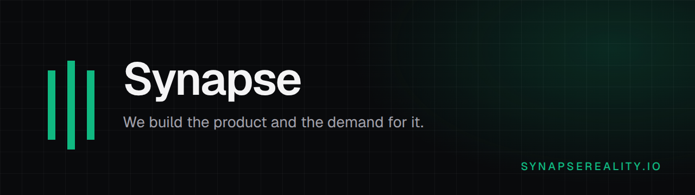

I run [Synapse](https://synapsereality.io/?utm_source=github&utm_medium=profile&utm_campaign=bensynapse), an AI-native growth engineering agency, since 2018. We build software and the demand for it. That means APIs, data pipelines, AI automations, and the search and answer-engine work that brings people to them.

| Where | Link |
|---|---|
| Website | [synapsereality.io](https://synapsereality.io/?utm_source=github&utm_medium=profile&utm_campaign=bensynapse) |
| Services | [synapsereality.io/services](https://synapsereality.io/services/?utm_source=github&utm_medium=profile&utm_campaign=bensynapse) |
| Free site audit | [synapsereality.io/tools/instant-audit](https://synapsereality.io/tools/instant-audit/?utm_source=github&utm_medium=profile&utm_campaign=bensynapse) |
| Book a call | [30 minutes on Google Meet](https://calendar.app.google/ajgUbVLqT5kL56hx8) |
